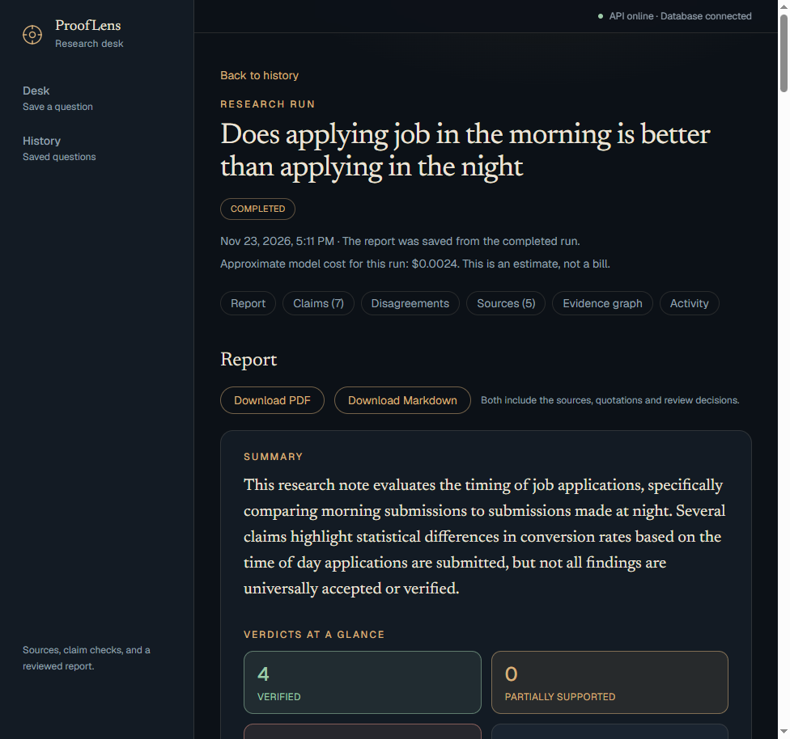
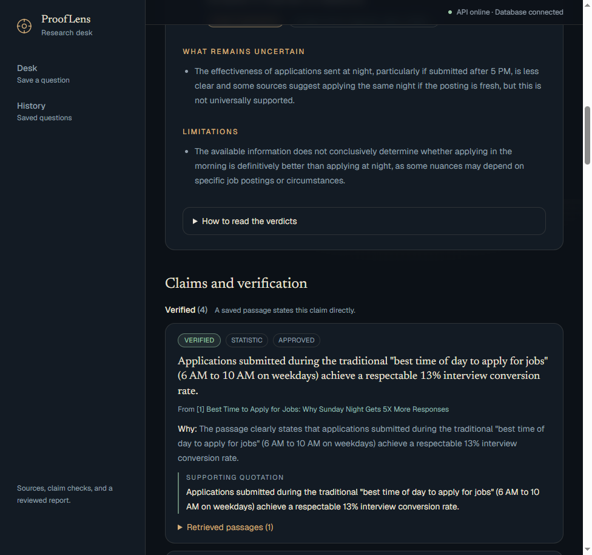

# ProofLens

ProofLens is a research desk that checks a question against sources it actually collected. Five agents search, extract claims, verify those claims against retrieved passages, look for contradictions, and wait for a person to approve or reject the claims before a cited report is written. The desk shows the saved sources, the evidence graph, the live agent activity, and Markdown or PDF exports of that same saved run.

A high evaluation score, a verified label, or a finished report is not a guarantee that a claim is true outside the passages that were collected.

## Problem

Search answers and model summaries often mix retrieved text with unsupported statements. A reader cannot see which sentence came from which page, which sources disagree, or whether a person looked at the claims before the report was written. ProofLens keeps those steps as data: sources, claims, quotations, disagreements, a review decision, and a report that can only cite the sources that were stored.

## Features

- A LangGraph workflow with a researcher, an extractor, a fact-checker, a contradiction detector, a human review interrupt, and a writer.
- An MCP server the workflow calls over stdio: `search_web`, `retrieve_source`, `extract_claims`, `verify_claim`, and `search_evidence`.
- Qdrant storage of source passages, with a separate embedding model from the chat model. A later question can retrieve a similar passage from an earlier session, labelled as memory, or an old copy labelled as possibly outdated.
- Verdicts of Verified, Partially supported, Contradicted, and Insufficient evidence. A supporting or opposing quotation is kept only when it appears in the passage.
- An evidence graph built from the saved foreign keys and passages.
- A review step. The report is not written until every claim is approved or rejected, or the reviewer asks for another search. Rejected claims stay stored and are left out of the writer packet.
- Server-sent agent activity, including reconnect with `Last-Event-ID`.
- Token totals and an approximate model cost on the research row, a per-run cost cap, and a limit on how many runs can start.
- Markdown and PDF export of the saved question, findings, claim groups, sources, contradictions, limitations, and bibliography.
- A curated evaluation of citation support, verification, retrieval, context relevance, answer overlap, freshness, and statistic backing. Ragas runs only when an API key is configured.

## Architecture

```mermaid
flowchart LR
  desk[Next.js desk]
  api[FastAPI]
  graph[LangGraph]
  mcp[MCP server stdio]
  qdrant[Qdrant]
  db[(PostgreSQL)]
  desk -->|REST and SSE| api
  api --> graph
  graph --> mcp
  mcp --> qdrant
  api --> db
  graph --> db
```

The HTTP request returns when the question is saved. The graph continues in the background and writes each stage. The desk renders only those saved rows and the events the agents emitted.

The MCP process is a child of the API. It is not a separate container. In Compose, Qdrant is reached over HTTP so the API and the MCP child share one server instead of opening the same on-disk folder.

## Multi-agent workflow

The graph is `researcher`, then `extractor`, then `fact_checker`, then `contradiction_detector`. It then pauses on `review` when a person must decide. After continue, `writer` runs. A retryable tool or model failure is tried once more. A missing key, or a run that passes the cost cap, stops without another model call.

1. The researcher plans one or two queries, searches, drops duplicate URLs, and fetches page text.
2. The extractor returns claims tied to a retrieved URL. Opinions are labelled and are not treated as facts.
3. The fact-checker reads each claim beside its passage and any similar stored passage. The quotation must occur in that text.
4. The contradiction detector stores a disagreement only when two factual claims from different sources cannot both be true. A different date or a different definition is discarded.
5. Review interrupts the graph. The thread id is the question id. Approving or rejecting must cover every claim. Asking for more research clears the children and returns to the researcher, up to two extra rounds.
6. The writer drafts from the claims that were not rejected. Citations that were not retrieved are removed.

PostgreSQL checkpoints survive an API restart. The in-memory checkpoint used by tests does not.

## Evidence graph

`GET /api/research/{id}/graph` returns nodes and edges from the saved sources, claims, evidence passages, and contradictions. The desk draws that response. Edges are those stored relationships. The interface does not add a decorative link that the database does not have.

## MCP

`python -m app.mcp.server` speaks MCP over stdio. The research graph uses that server when a test has not substituted its own search and fetch functions. Tool errors come back as tool errors. They are not stored as sources.

Retrieved page text is wrapped in `<untrusted_source>` in the prompt. The wrapper tells the model that the page is data. The fact-checker still checks quotations against the original passage. A page cannot close the wrapper early and then issue an instruction. This is a prompt boundary, not a sandbox. A model can still quote a false or misleading sentence that really appears on the page.

## RAG

Passages are chunked and embedded into the `prooflens_evidence` collection. The default embedder is fastembed with `BAAI/bge-small-en-v1.5`. `OPENAI_MODEL` does not choose that vector model. Tests set `EMBEDDING_PROVIDER=hash` and `QDRANT_PATH=:memory:` so they do not download a model.

A search for the current session uses `RETRIEVAL_MIN_SCORE`. A passage from another session is returned only above `MEMORY_MIN_SCORE` and is marked `from_memory`. A copy older than `MEMORY_FRESH_DAYS` is fetched again, or marked `possibly_outdated` when the fetch fails. Unrelated passages fall under the bar and are not returned.

## Technology

- Python, FastAPI, SQLAlchemy, PostgreSQL, LangGraph
- The official MCP Python SDK
- Qdrant and fastembed
- OpenAI for the chat model, Tavily for search
- Ragas 0.2.15, installed from `requirements-eval.txt` and imported only for the optional model-judged metrics
- fpdf2 for PDF export
- Next.js, React, and Tailwind

## Folder structure

```
backend/app/api            HTTP routes
backend/app/research       graph, agents, retrieval, export, persistence
backend/app/mcp            MCP server, tools, and the stdio client
backend/app/evaluation     curated dataset, metrics, and the Ragas adapter
backend/app/models         SQLAlchemy tables
database/schema.sql        PostgreSQL contract
frontend                   Next.js desk
docker                     API and desk Dockerfiles
docs                       architecture and deployment notes
```

`explanation.txt` and `scripts/push.ps1` are local files. They are listed in `.gitignore` and are not part of the public tree.

## Installation

You need Python 3.11 or newer, Node.js 20 or newer, and PostgreSQL 15 or newer for a real save. The automated tests do not need PostgreSQL, Qdrant, OpenAI, or Tavily.

From the repository root:

```powershell
Copy-Item .env.example .env
```

Create the database before the first real save:

```sql
CREATE USER prooflens WITH PASSWORD 'prooflens';
CREATE DATABASE prooflens OWNER prooflens;
```

The password in `.env.example` and in `docker-compose.yml` is a local placeholder. Change it if anyone else can reach that database.

Backend:

```powershell
cd backend
python -m venv .venv
.\.venv\Scripts\Activate.ps1
pip install -r requirements.txt
uvicorn main:app --reload
```

The API listens on http://localhost:8000. Interactive docs are at http://localhost:8000/docs until `ENVIRONMENT` is `production`.

Frontend, in a second terminal:

```powershell
cd frontend
npm install
npm run dev
```

Open http://localhost:3000. The desk calls http://localhost:8000 unless `frontend/.env.local` sets `NEXT_PUBLIC_API_URL`.

## Environment

The root `.env.example` lists every variable. Environment variables override the file.

- `DATABASE_URL` is PostgreSQL in normal use. Tests set SQLite before the app is imported.
- `OPENAI_API_KEY`, `OPENAI_MODEL`, and optional `OPENAI_BASE_URL` configure the chat model. Leave the key empty to run tests only.
- `REQUIRE_USER_KEYS` is `true` in Compose. A visitor then enters their own OpenAI and Tavily keys under "API keys" on the desk. The browser keeps them in the tab (sessionStorage) and sends them as `X-OpenAI-Key` and `X-Search-Key` headers on the start and review requests. The server holds them in memory for that run, passes them to the MCP child over its stdio pipe, and does not store or log them. The host's own keys are ignored. A request without keys gets `400` before any row is saved. Locally the default is `false`, and `.env` keys are used.
- `SEARCH_PROVIDER` is `tavily`. `SEARCH_API_KEY` is required for a live search.
- `EMBEDDING_PROVIDER` is `fastembed` or `hash`. `EMBEDDING_MODEL` is separate from `OPENAI_MODEL`.
- `QDRANT_URL` empty means the local `.qdrant` directory. Set the URL to use a Qdrant service. Do not point the API and another process at the same local path.
- `PROMPT_PRICE_PER_MILLION`, `COMPLETION_PRICE_PER_MILLION`, and `MAX_RUN_COST_USD` control the estimate and the cap. The estimate is not a bill.
- `MAX_CONCURRENT_RUNS` and `MAX_RUN_STARTS` limit new research starts. The limiter lives in the API process and is shared by every caller, not kept per client or per address. A review resume, including `research_more`, is not counted as a new start, so it is not capped by `MAX_RUN_STARTS`.

On startup the API creates tables it can reach and adds missing question columns, including the token and cost columns. `database/schema.sql` is the same contract. There is no Alembic chain.

## Docker

From the repository root, with Docker installed:

```powershell
docker compose up --build
```

Compose starts PostgreSQL 16, Qdrant, the API, and the desk. Health checks gate the API on Postgres and Qdrant, and the desk on the API. The API image runs as a normal user, and Qdrant is pinned to a release the client library accepts. Volumes keep the database, Qdrant storage, and the embedding cache. The desk is built with `NEXT_PUBLIC_API_URL=http://localhost:8000`, which is the URL the browser uses. Compose sets `REQUIRE_USER_KEYS=true`, so enter your own OpenAI and Tavily keys under "API keys" on the desk before you start a run. To use server-side keys on a private install instead, set `REQUIRE_USER_KEYS=false` and pass `OPENAI_API_KEY` and `SEARCH_API_KEY` in the shell. Keys are never copied into the image. `.env`, `explanation.txt`, virtual environments, and local databases are in `.dockerignore`.

This Compose file is the local packaging. It was built and started once with Docker Desktop on Windows: all four services reached healthy, `/api/health` reported PostgreSQL and Qdrant connected, the API ran as a non-root user, and a run with placeholder keys was saved and failed cleanly with a key-rejected message, and a run with real OpenAI and Tavily keys completed (see Results from a real run). A hosted deployment has not been done. See `docs/deployment.md`.

## API

| Method | Path | Behaviour |
| --- | --- | --- |
| GET | `/api/health` | Database and, when `QDRANT_URL` is set, Qdrant. `503` when the database is down or a configured Qdrant URL does not answer. |
| GET | `/api/research` | Newest questions, up to the `limit` query. |
| POST | `/api/research` | Saves a question and starts the graph. `429` when the start cap is reached. |
| GET | `/api/research/{id}` | Question, sources, claims, evidence, contradictions, report, and token estimate. |
| GET | `/api/research/{id}/graph` | Evidence-graph nodes and edges. |
| POST | `/api/research/{id}/review` | Continue with one decision per claim, or `research_more`. `409` when the run is not waiting. `422` when a decision is missing. |
| GET | `/api/research/{id}/events` | Server-sent activity. Send `Last-Event-ID` to resume. |
| GET | `/api/research/{id}/export.md` | Markdown download of the saved run. |
| GET | `/api/research/{id}/export.pdf` | PDF download of the saved run. |

A question is `running` while the graph works and while it waits at `awaiting_review`. It becomes `completed` when a report is saved, or `failed` when a step stops the run.

## Screenshots

The desk is the Next.js app at `/`, `/history`, and `/research/[id]`. These two screenshots are of the real run described below, taken from the Compose stack.





## Evaluation

From `backend`, with the virtual environment active:

```powershell
python -m app.evaluation
```

The dataset has seven labelled rows: a correct claim, an incorrect claim quoted from a true sentence (the product now downgrades it, so the safe label is Insufficient evidence), contradictory sources, a passage that is too short, a retrieval time outside the freshness window, a misleading excerpt that names a figure in order to deny it, and a statistic whose number is not in the excerpt.

The deterministic metrics are:

- **Citation support.** The quotation the verdict relies on occurs in the passage.
- **Claim verification.** After grounding, the status matches the label.
- **Retrieval quality.** The hashing embedder ranks the labelled passage above an unrelated passage and above the retrieval floor.
- **Context relevance.** The question shares more words with the labelled passage than with the distractor.
- **Answer grounding.** How many content words of the answer appear in the passages. This is overlap, not entailment.
- **Source freshness.** The product's freshness rule matches the label for that timestamp.
- **Statistic backing.** For a Verified or Partially supported statistic, every number in the claim appears in the excerpt.

Ragas faithfulness, answer relevancy, and context precision are requested only when `OPENAI_API_KEY` is set. If the key is missing, or the library cannot be imported, the result is `ran: false` and no score is filled in. To get it, run `pip install -r requirements-eval.txt`. Ragas 0.2.15 is pinned because later releases need scikit-network, which needed a C++ compiler to build during development. Current LangChain no longer ships a class that release imports, so `app.evaluation.ragas_eval` installs a placeholder for that import and does not call it.

These scores measure the curated rows and the quotation rules. A high score does not guarantee factual correctness. Citation support stays high when a false claim quotes a true sentence. The product now also refuses to keep a statistic as Verified when its quotation lacks the claim's numbers, so the incorrect-claim and unsupported-statistic rows end as Insufficient evidence. The statistic-backing metric still reports the raw verdict, so it scores those rows 0. The remaining gap is the misleading-excerpt row: the quoted sentence names the figure in order to deny it, so number matching passes and claim verification scores 0. Only the deterministic metrics have produced numbers. No Ragas score has been obtained.

## Results from a real run

One question was run on 23 Nov 2026 through the Compose stack, with the visitor's own OpenAI and Tavily keys entered in the desk and a person approving the claims. The saved exports are in `docs/sample-run/` ([report.md](docs/sample-run/report.md) and [report.pdf](docs/sample-run/report.pdf)).

Question: "Does applying job in the morning is better than applying in the night" (typed as written).

| Measure | Result |
| --- | --- |
| Status | Completed |
| Sources saved | 5 |
| Claims extracted | 7 (all 7 approved in review) |
| Verdicts | 4 Verified, 3 Insufficient evidence, 0 Partially supported, 0 Contradicted |
| Contradictions found | 0 |
| Report findings | 5 (4 supported, 1 partly supported) |
| Model use | 9,362 prompt and 1,731 completion tokens, about $0.0024 at the configured prices (an estimate, not an invoice) |

The saved time from start to finish was almost ten minutes. That includes the time spent waiting for the review decision, and the stage timings were not saved, so this is not a measure of processing speed.

What the run showed:

- The stack works end to end on real services: search, page text, claim extraction, verification, the review pause, the report, the evidence graph, and both exports.
- A Verified label means the saved text states the claim. All five sources were career-advice or recruiting pages (four classed secondary, one with incomplete primary-source signals), so the verified figures such as "13% interview conversion" are statistics those pages repeat. The run did not show that the figures are true.
- For four of the five sources the stored text is identical to the search-result snippet, at most 1,000 characters. Only the university page has longer fetched text. Verification for those four was against search-result text, not the full page.
- One saved source is a Cloudflare error page ("Just a moment..." from indeed.com, 111 characters). No claim was taken from it, but it still sits in the source list and the bibliography. A page like that should be filtered out before it is stored, and that is not done yet.
- The "Tuesday to Thursday" finding is labelled partly supported although both claims taken from its cited source were checked as Insufficient evidence. The finding label is the writer's, and the app only downgrades a "supported" label that has no verified claim behind it.

Not run: the curated evaluation (`python -m app.evaluation`) was not run against this stack, and no Ragas score exists. This was a single run, so it says nothing about accuracy or speed in general.
## Tests

Backend, from `backend`:

```powershell
pytest
```

At the last run the backend suite had 89 passing tests and 1 skipped (the live test), and the frontend had 18 passing tests. The suite uses in-memory SQLite, in-memory Qdrant, the hashing embedder, and stand-ins for search and the model. It covers the API, the agents, the graph, the database contract, MCP, retrieval, export, the cost and start limits, and the curated evaluation. One live test is marked `e2e` and skips without both API keys.

```powershell
pytest -m e2e
python -m app.research.live "What evidence links consistent sleep to memory consolidation in adults?"
```

The live command exits with an error if a key is missing or a step fails. It does not invent a report.

Frontend, from `frontend`:

```powershell
npm test
```

## Security

- Secrets belong in the environment or a local `.env`. `.env` is gitignored. Images do not copy it.
- Logs record status codes, the database dialect, and token counts. They do not record the API key, the prompt body, or the page text. SQLAlchemy does not log bound parameters, and database connection failures log the exception type.
- Question text is length-checked. List limits are bounded. Research ids are UUIDs. SQL is issued through SQLAlchemy parameters or fixed `ALTER` statements, not by concatenating the question into SQL.
- New runs are limited. Model calls time out, and the OpenAI client retries once before the graph's own retry. The cost cap is not retried.
- Web pages are untrusted. They are wrapped before they enter a prompt and cannot close that wrapper, but the only protection against injected instructions is the model following that wrapper. Tool execution is the fixed MCP tool list, not code taken from a page.
- Page fetches only go to public addresses. Every host is resolved, private, loopback, link-local, and metadata addresses are refused, and each redirect hop is checked again. A DNS answer that changes between the check and the connection is not defended against.
- Model tokens spent in the MCP child process are returned in the tool result and added to the run, so the cost cap covers both processes.
- A run still marked running when the API starts, other than one waiting for review, is marked failed with a message to ask again. Its in-memory work cannot be resumed.
- Each graph thread id is the question id. Memory hits from another session are labelled and use a higher similarity bar. Export citations have to match a source saved on that session.
- Remaining limits: there is no login, so anyone who can call the API can read saved research. The cost figure can drift from the provider bill. Prompt wrapping is not a sandbox. A quotation check does not detect sarcasm or a denial that still contains the quoted words. TLS, a real database password, and closed database ports are required on any shared host and are not configured by the local Compose file.

## Known limitations

- Live research needs OpenAI and Tavily keys. Without them the workflow stops with an error instead of filling in sources.
- Verification is against collected text. A verified claim can still be false if the page is false.
- The freshness window and the similarity floors are settings, not a judgment that a page is current or authoritative.
- Source-quality labels are rules about the publisher, author, date, and passage. They are not a reliability score.
- The limiter and the activity log live in the API process. A restart drops events that were not already shown. The saved rows remain.
- PDF text is written in Helvetica. Characters outside Latin-1 are replaced.
- Ragas model-judged metrics are optional, and no Ragas score has been produced yet.
- Bot-challenge and error pages from a site can be stored as sources. Search snippets can stand in for page text when the page is not fetched.
- Docker Compose was started and used on one Windows machine. A public deployment was not performed or verified.

## Further work

- Accounts, so one session cannot read another.
- A migration tool once the schema needs changes that `create_all` cannot express.
- A hosted run with TLS, backups, and a checked health endpoint.
- A stronger check for quotations that appear inside a denial.
- Evaluation rows taken from finished research sessions, still without treating the score as proof.
